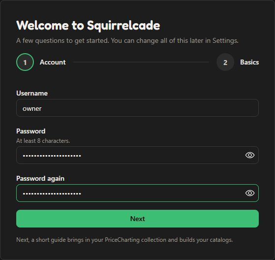
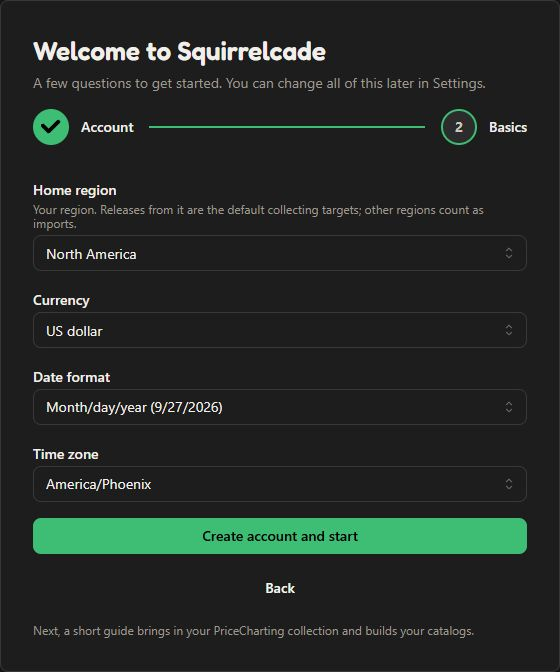
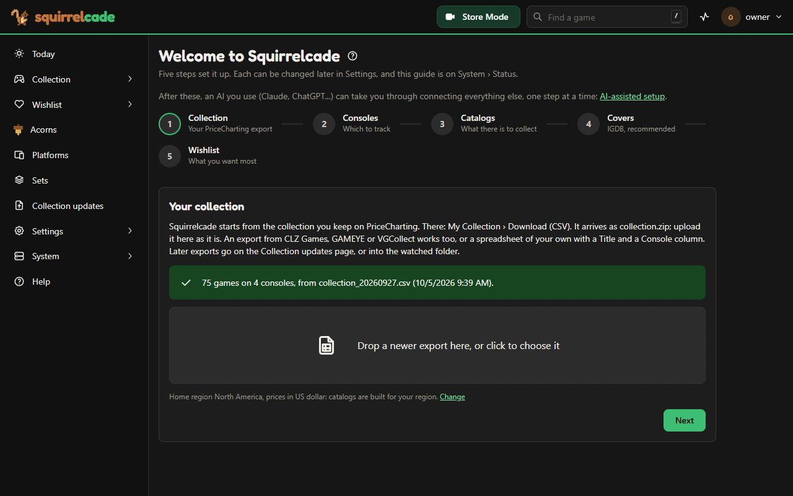
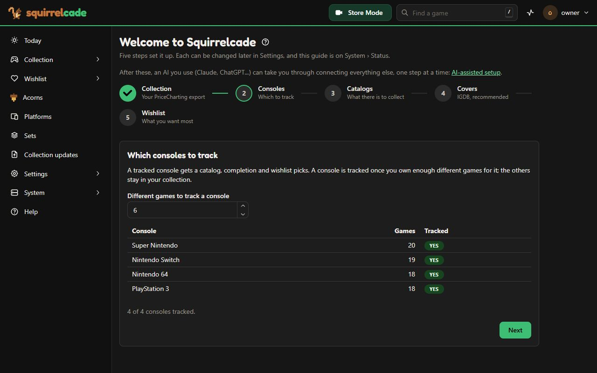
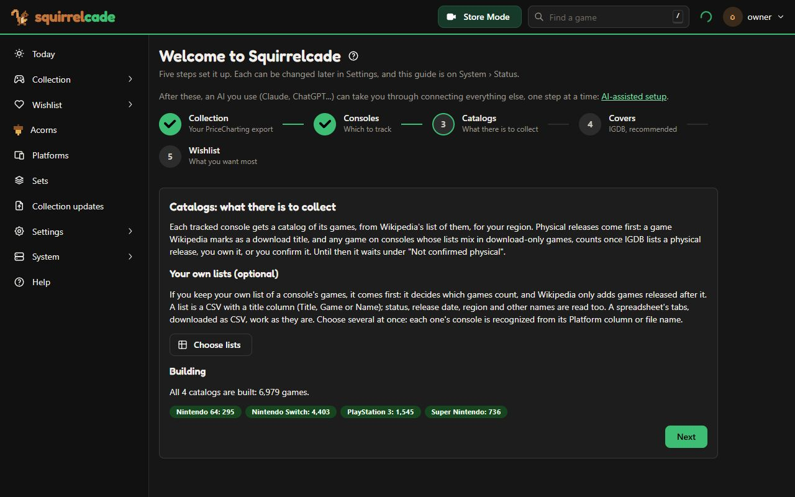
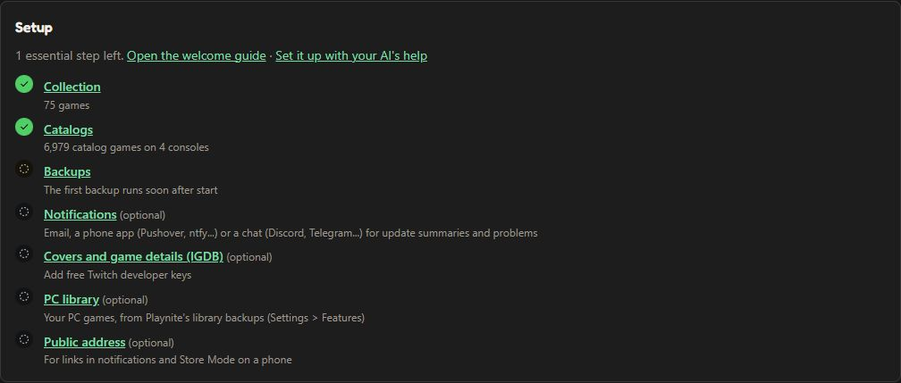

# 2. The first visit

Open Squirrelcade's address in a browser on a computer at home. Not sure what it is? See [Check that it worked](install.md#check-that-it-worked).

## Your account

The first page makes the **owner's account**, the one that owns the collection:

1. Type a **Username** and a **Password** (at least 8 characters; a few words together is easy to remember), and the password again in **Password again**. Opening Squirrelcade from outside your home network? The page then starts with a **Setup code** box: the code is in Squirrelcade's log, on the line that begins "No account yet" (see [Check that it worked](install.md#check-that-it-worked)).
2. Click **Next**. Pick your **Home region** (it fills in the usual currency and date format), your **Currency** (values are shown in it; Squirrelcade doesn't convert them), your **Date format** and your **Time zone**.
3. Click **Create account and start**.

All of these can change later in **Settings > General**.

 

## Your collection

The **welcome guide** starts right after. Its first step brings your games in, whichever way suits you (only the first needs an account somewhere):

- **From PriceCharting** (if you keep your collection there): **My Collection > Download (CSV)**. PriceCharting emails you a link; the file is `collection.zip`. Drop the zip into the welcome guide as it is (or the CSV inside it). Keep its name if you unzip it (`collection_YYYYMMDD.csv`): its date is the date of the prices. It brings each copy's value (a spreadsheet of your own can too, with a Value column).
- **From another app or a spreadsheet:** an export from CLZ Games, GAMEYE or VGCollect, or a spreadsheet of your own saved as CSV with a **Title** and a **Console** column: see [a spreadsheet of your own](../help/collection.md#a-spreadsheet-of-your-own-instead).
- **By hand:** **Add games one at a time** opens **Add a game** (also in the menu, under **Acorns**). Pick the console, type the title, and **Add it**: a short walk-through asks its condition, what you paid, the day and your notes, then the photos that condition calls for (each with **Skip**), and **Save and close**. When you're done, **Back to the welcome guide** at the top of the page takes you to the next step. (Later, **System > Status > Open the welcome guide** brings it back.)

An export shows what Squirrelcade found in it: how many games on which consoles, and anything it couldn't read. **Next** works once at least one game is in.

## Consoles and catalogs

- **Consoles:** a console gets a **catalog** (the list of its games, to see what you're missing) once you own a few different games for it: 6 by default (Settings > Consoles). Typing your games in by hand? Until a console has its catalog, Add a game suggests only the games you've added to it. Set that number to 1 for a catalog after the first game.
- **Catalogs:** Squirrelcade builds each one from Wikipedia's list of the console's games, physical releases first. It takes a few minutes the first time (Wikipedia is asked politely, one page at a time); the **activity** icon at the top shows the work going on. If you keep your own list of a console's games, you can use it instead (a console's page > "Where this catalog comes from").

## The wishlist, and what comes after

- **Wishlist:** the guide's last step asks one question on a new install, **What your wishlist is**. **Suggested** (the start) is Squirrelcade's own ranked list of the games you're missing, as acorns order them. **Picked by you** is a list of only the games you add yourself (from Suggestions, a game's page or Store Mode); the ranked list stays as Suggestions to choose from. You can change it any time on **Acorns**.
- **Add these any time:** the guide ends with the list of everything optional (covers from IGDB, messages, your email, your PC games, YouTube videos, friends' live links, Claude...), with how long each takes. None is asked now: Squirrelcade works without them, and **Settings > Features** has the same list, each with a **Set it up with AI** button that copies a prompt for just that one. Look around first, then add what you want, one at a time.

## Check that it worked

**System > Status** has a **setup checklist**: what's done, what's left, each with a link to where it's done. Until the essential steps are done, it's also at the top of **Today**.

- **Nutshell > Consoles** lists your consoles with their completion (for example "PlayStation 3: 312 of 1,847").
- **Stash** lists your copies, with their value from a PriceCharting export (or none, for games added by hand).
- **System > Review** may have questions: titles that look alike ("Doraemon 2" and "Doraemon 2: Nobita no Toys Land Daibouken"). Answer a few; each answer counts everywhere. [How matching works](../MATCHING.md) explains when a copy counts.

Numbers that look wrong? Open a console's page, then a game you own that shows as missing: its drawer says what the catalog has and why the copy didn't count.

Next: [reach it from your phone](phone.md), for Store Mode in a store. Or add what you want from **Settings > Features**, one feature at a time, each with its own AI prompt (or the whole-install prompt in [AI-assisted setup](../help/ai-setup.md), which starts by asking: a quick start, or everything now).
